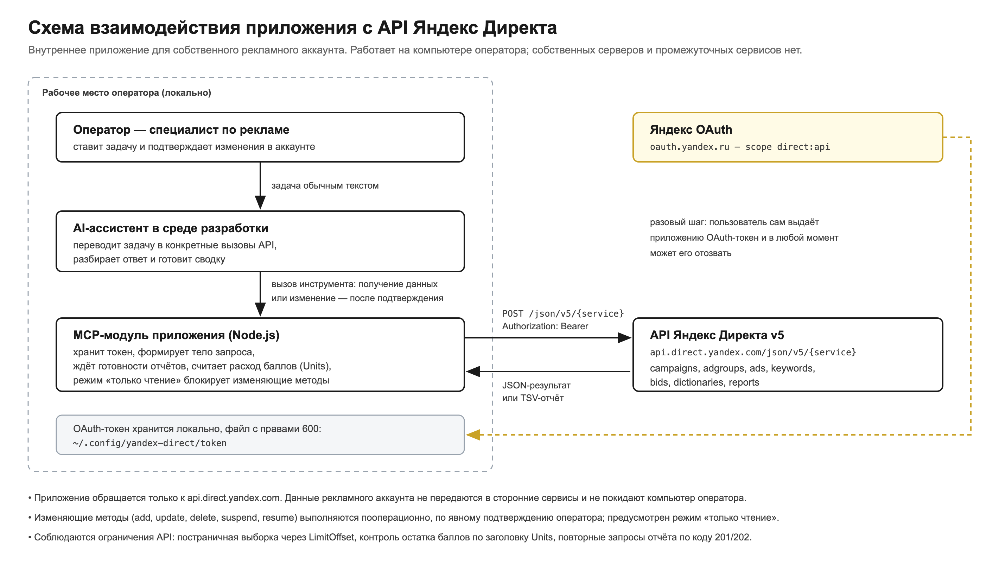

# yandex-direct-mcp

MCP-сервер для **Яндекс Директ API v5**. Подключает рекламный аккаунт к AI-агенту (Claude Code, Cursor и любому другому MCP-клиенту): задача ставится обычным текстом, агент сам собирает нужные вызовы API и разбирает ответ.

```
Ты:    посмотри, куда за август ушёл бюджет и что откручивается без конверсий
Агент: [direct_report] → 12 кампаний, 340 фраз
       Расход 214 800 ₽. Кампания «Поиск / Бренд» — 38%, CPA 610 ₽.
       17 фраз потратили 31 400 ₽ при нуле конверсий — вот они, отключаем?
```

Без зависимостей: один файл на Node.js, транспорт stdio, запросы через встроенный `fetch`.

- **Токен хранится локально** в файле с правами 600 и никуда, кроме `api.direct.yandex.com`, не уходит.
- **Изменения — по подтверждению.** MCP-клиент спрашивает разрешение на каждый вызов; плюс есть режим «только чтение», который блокирует изменяющие методы на уровне сервера.
- **Полный API, а не подмножество.** Универсальный инструмент `direct_call` покрывает все сервисы v5 — от `campaigns` до `keywordsresearch`.

## Что можно делать

**Аналитика.** Отчёты по любому срезу и периоду: кампании, группы, объявления, ключевые фразы, поисковые запросы, гео, устройства, время суток, пол и возраст. Расход, клики, CTR, CPC, конверсии, CPA, сравнение периодов. Разбор поисковых запросов на мусор, поиск фраз с расходом без конверсий.

**Управление.** Создание и правка кампаний, групп, объявлений, ключевых фраз. Ставки и дневные бюджеты — в том числе пакетно, по правилу («CPA выше 2000 ₽ → срезать ставку на 20%»). Минус-слова, включение и остановка, отправка на модерацию, корректировки ставок по гео, устройствам и аудиториям, ретаргетинг.

**Семантика.** Проверка частотности фраз (`keywordsresearch`), справочники регионов и часовых поясов (`dictionaries`).

**Регулярные задачи.** Утренняя сводка расхода за вчера, еженедельный разбор поисковых запросов, оповещение о перерасходе — если MCP-клиент умеет расписание.

Подробные сценарии с примерами запросов: [docs/usage.md](docs/usage.md).

## Требования

- Node.js 18 или новее (нужен встроенный `fetch`).
- Аккаунт Яндекс Директа.
- Зарегистрированное приложение на [oauth.yandex.ru](https://oauth.yandex.ru) **с одобренной заявкой на доступ к API**. Это главный барьер, и он занимает от часа до трёх суток — начни с него: [docs/registration.md](docs/registration.md).

## Установка

```bash
git clone https://github.com/<owner>/yandex-direct-mcp.git
cd yandex-direct-mcp
```

Зависимостей нет, `npm install` не нужен.

**Claude Code:**

```bash
claude mcp add yandex-direct --scope user -- node "$PWD/server.js"
```

**Cursor, Windsurf и другие клиенты с JSON-конфигом:**

```json
{
  "mcpServers": {
    "yandex-direct": {
      "command": "node",
      "args": ["/абсолютный/путь/yandex-direct-mcp/server.js"]
    }
  }
}
```

Инструменты появляются при старте клиента — после добавления сервера перезапусти сессию.

## Авторизация

Порядок важен. Если сделать не в этом порядке, получишь ошибку 58 и потеряешь время — мы потеряли.

### 1. Заявка на доступ к API

Регистрируешь приложение на [oauth.yandex.ru](https://oauth.yandex.ru) и подаёшь заявку в интерфейсе Директа: [«Мои заявки»](https://direct.yandex.ru/registered/main.pl?cmd=apiCertificationRequestList). Рассмотрение — в рабочие дни РФ с 10:00 до 19:00, от часа до трёх суток, в пиковые периоды до семи дней.

Что писать в форме (готовые тексты для всех полей, включая описание схемы взаимодействия и диаграмму) — [docs/registration.md](docs/registration.md).

**Без одобренной заявки не работает даже песочница.** Проверено: `api-sandbox.direct.yandex.com` отдаёт ту же ошибку 58, что и боевой API. Отладиться «пока на тестовых данных» не получится.

### 2. Токен

```bash
./save-token.sh <CLIENT_ID>
```

Скрипт покажет ссылку авторизации, дождётся, пока ты вставишь адресную строку после редиректа (ввод скрытый — ни URL, ни токен не попадают в историю shell), вытащит `access_token`, положит в `~/.config/yandex-direct/token` с правами 600 и сразу прогонит проверку доступа.

`<CLIENT_ID>` — идентификатор **того приложения, на которое одобрена заявка**. Скрипт запомнит его в `config.json`, дальше можно запускать без аргумента.

Вручную то же самое: открыть `https://oauth.yandex.ru/authorize?response_type=token&client_id=<CLIENT_ID>`, забрать токен из адресной строки после `#access_token=` (до `&`) и положить в файл.

### 3. Проверка

```bash
printf '%s\n' \
  '{"jsonrpc":"2.0","id":1,"method":"initialize","params":{"protocolVersion":"2025-06-18","capabilities":{}}}' \
  '{"jsonrpc":"2.0","id":2,"method":"tools/call","params":{"name":"direct_status","arguments":{}}}' \
  | node server.js
```

Либо просто спроси у агента: «проверь доступ к Директу». Успешный ответ показывает логин, валюту аккаунта и остаток баллов.

## Грабли, на которые мы напоролись

| Симптом | Причина | Что делать |
|---|---|---|
| `error 58` — «Незавершенная регистрация», хотя заявка одобрена | Токен получен под **другим приложением**, не тем, на которое одобрена заявка. Легко нарваться, если приложений несколько | Открой одобренную заявку, сверь Client ID, получи токен именно под ним |
| `error 58` в песочнице | Песочница тоже требует одобренной заявки | Ждать одобрения, обходного пути нет |
| Повторная авторизация возвращает **тот же самый** токен | Яндекс отдаёт уже выданный токен, пока доступ приложению не отозван | Отозвать доступ на [id.yandex.ru/personal/data-access](https://id.yandex.ru/personal/data-access), затем авторизоваться заново |
| `error 53` — «Недействительный OAuth-токен» | Токен отозван, истёк или скопирован с обрезкой | Получить заново через `./save-token.sh` |
| `clients.get` отвечает, но `campaigns.get` возвращает пустой список | Токен выдан под логином, в котором нет кампаний | Получить токен под нужным логином. Повторная заявка не нужна: она одобрена на приложение, а не на пользователя |
| Заявку требуется подать повторно после пересоздания приложения | Одобрение привязано к Client ID, а не к аккаунту | Не удалять одобренное приложение. Если удалил — новая заявка, в описании сослаться на прежний Client ID |

Отдельно: **токен нельзя вставлять в чат агента** — он осядет в истории переписки. Для этого и сделан `save-token.sh` со скрытым вводом. Если всё же вставил — отзови доступ на [id.yandex.ru/personal/data-access](https://id.yandex.ru/personal/data-access) и получи новый.

## Инструменты

| Инструмент | Назначение |
|---|---|
| `direct_status` | Есть ли токен, какая среда, живой ли доступ (пробный `clients.get`), остаток баллов. Токен не раскрывается |
| `direct_reference` | Шпаргалка: сервисы, методы, примеры `params`, типы отчётов, единицы ставок, лимиты |
| `direct_call` | Универсальный вызов `POST /json/v5/{service}` с телом `{method, params}` |
| `direct_report` | Reports API: отправляет ReportDefinition, дожидается готовности (коды 201/202), возвращает TSV |

## Конфигурация

`~/.config/yandex-direct/config.json`:

```json
{
  "token": "",
  "client_id": "…",
  "client_login": "",
  "sandbox": false
}
```

Токен читается при каждом вызове — после его замены сервер перезапускать не нужно.

| Переменная окружения | Смысл |
|---|---|
| `YANDEX_DIRECT_TOKEN` | Токен напрямую, приоритетнее файлов |
| `YANDEX_DIRECT_CLIENT_LOGIN` | Логин клиента для агентского аккаунта (заголовок `Client-Login`) |
| `YANDEX_DIRECT_SANDBOX=1` | Работать с песочницей |
| `YANDEX_DIRECT_READONLY=1` | Блокировать `add`, `update`, `delete`, `suspend`, `resume`, `moderate`, `set` |
| `YANDEX_DIRECT_CONFIG_DIR` | Другой каталог конфигурации |

Порядок поиска токена: `YANDEX_DIRECT_TOKEN` → `config.json` → `~/.config/yandex-direct/token`.

## Лимиты и стоимость

Каждый вызов тратит баллы (Units); остаток приходит в заголовке ответа и печатается в шапке результата. Обычный `get` — около 10 баллов, отчёты дороже. Суточный лимит зависит от аккаунта (у обычного клиента — порядка 160 000, на живую работу с запасом).

Метод `get` отдаёт максимум 10 000 объектов за раз — дальше постранично через `LimitOffset`. Ставки задаются в микроединицах: `30000000` = 30 ₽. У отчёта `ReportName` должен быть уникальным, иначе Директ вернёт ранее сформированный отчёт.

## Схема взаимодействия



Исходник: [docs/scheme.html](docs/scheme.html) — пригодится, если понадобится своя версия картинки для заявки.

## Лицензия

MIT — см. [LICENSE](LICENSE).
